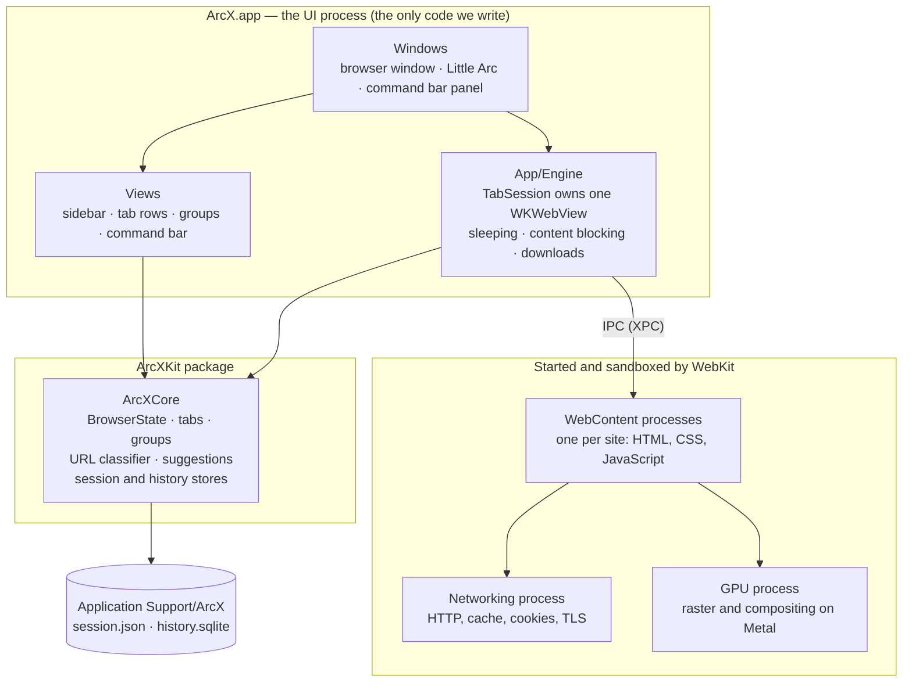

# Architecture

One rule shapes the layout: **browser state and logic live in `ArcXCore`; the app is windows, views and a thin WebKit layer on top of it.** `ArcXCore` imports neither AppKit nor WebKit, so everything that decides what the browser does (which tabs exist, what a typed string means, what the command bar suggests) is tested headless in milliseconds.

A second rule keeps the engine replaceable: **`import WebKit` appears only under `App/Engine`.** The sidebar, command bar and model never see a `WKWebView`.

## Processes

| Process | Started by | Does |
|---|---|---|
| `ArcX.app` | the user | Windows, tabs, the command bar, history, the session. All of our code |
| WebContent | WebKit, per site | Parses and runs a page inside its own sandbox |
| Networking | WebKit | Every request, the cache, cookies |
| GPU | WebKit | Draws pages with Metal and hands the app finished layers |

A crashed or sleeping tab costs one WebContent process, never the app.

## Targets

| Target | Depends on | Holds |
|---|---|---|
| `ArcXCore` | nothing yet (GRDB from M2) | Models, `BrowserState`, URL classification, suggestion ranking, session and history stores |
| `App/` | ArcXCore, AppKit, SwiftUI | Windows and views |
| `App/Engine` | ArcXCore, WebKit | `TabSession`, web view configuration, tab sleeping, content blocking, downloads |

## Windows and views

AppKit owns windows and the web view container, because `WKWebView` is an `NSView` and AppKit gives exact control of the title bar, panels and focus. SwiftUI draws what sits inside the sidebar and the command bar, hosted with `NSHostingView`. The app uses the AppKit lifecycle (`main.swift` and an app delegate), not SwiftUI's `App`, so tests can start it without a Dock icon or a visible window.

## State and storage

`BrowserState` is the single source of truth and is observable; views read it and never keep their own copy of tab data.

| Store | Format | Purpose | Arrives |
|---|---|---|---|
| Session | `session.json` | Tabs, groups, pinned tabs, selection; rewritten shortly after each change | M1 |
| History | `history.sqlite` with FTS5 | Visits, searched from the command bar | M2 |
| Favicons | files on disk | Icons for the sidebar and suggestions | M2 |

## Tab lifecycle

A tab is data first and a web view second. Only tabs the user has looked at recently hold a `WKWebView`.

| State | Holds a web view | Enters when |
|---|---|---|
| Restored | no | The app launches; only the selected tab is loaded |
| Live | yes, in the window | The tab is selected |
| Background | yes, out of the view hierarchy, so WebKit throttles it | Another tab is selected |
| Asleep | no; its navigation state is saved | It has been in the background for a while, or the system is short of memory. Tabs playing media stay awake |

Lazy restore and sleeping arrive in M6.

## How web content is contained

Pages run in WebKit's own sandboxed processes, separate from the app. The app itself is not under the App Sandbox while it is a development build; that decision is revisited before any signed release.
