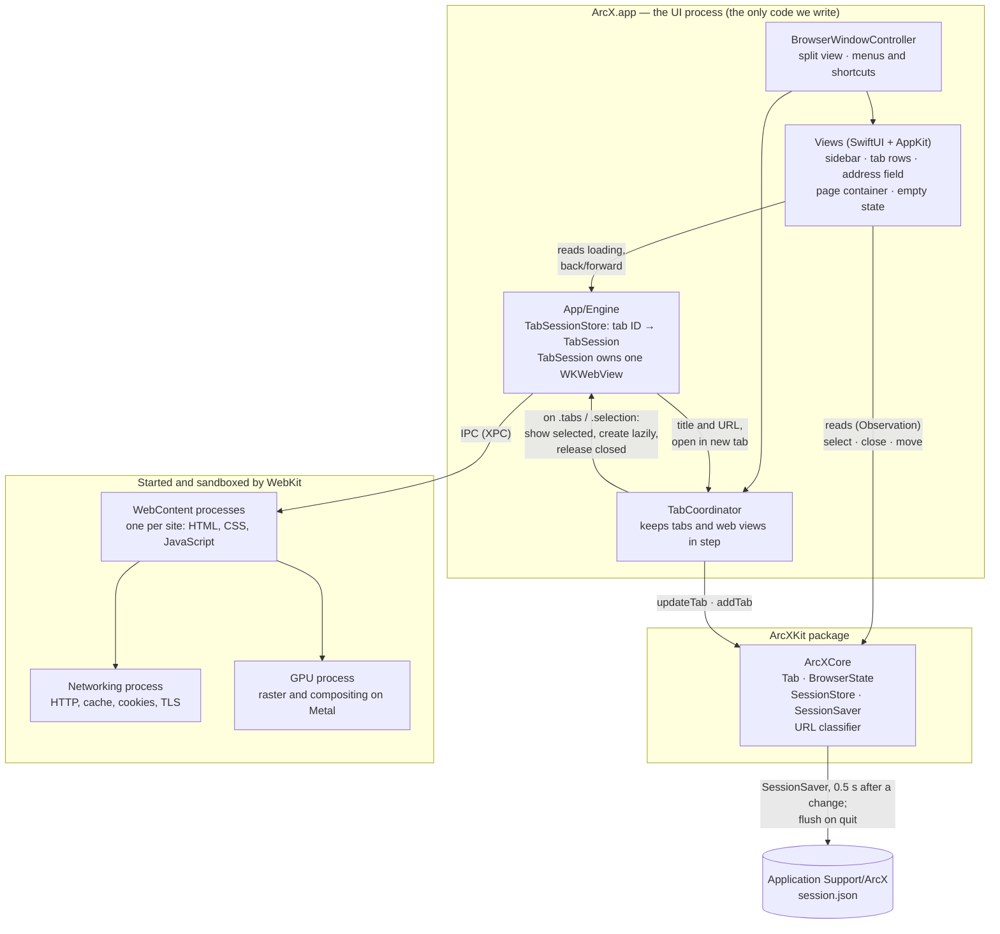

# Architecture

One rule shapes the layout: **browser state and logic live in `ArcXCore`; the app is windows, views and a thin WebKit layer on top of it.** `ArcXCore` imports neither AppKit nor WebKit, so everything that decides what the browser does (which tabs exist, what a typed string means, what the command bar suggests) is tested headless in milliseconds.

A second rule keeps the engine replaceable: **`import WebKit` appears only under `App/Engine`.** The sidebar, command bar and model never see a `WKWebView`.

## Processes

| Process | Started by | Does |
|---|---|---|
| `ArcX.app` | the user | Windows, tabs, the command bar, history, the session. All of our code |
| WebContent | WebKit, per site | Parses and runs a page inside its own sandbox |
| Networking | WebKit | Every request, the cache, cookies |
| GPU | WebKit | Draws pages with Metal and hands the app finished layers |

A crashed or sleeping tab costs one WebContent process, never the app.

## Targets

| Target | Depends on | Holds |
|---|---|---|
| `ArcXCore` | Foundation and Observation only (GRDB from M2) | `Tab`, `BrowserState`, `SessionStore` and `SessionSaver`, URL classification; later suggestion ranking and history |
| `App/` | ArcXCore, AppKit, SwiftUI | The browser window, `TabCoordinator`, the sidebar and other views |
| `App/Engine` | ArcXCore, WebKit | `TabSession`, `TabSessionStore`, web view configuration; later tab sleeping, content blocking, downloads |

## Windows and views

AppKit owns windows and the web view container, because `WKWebView` is an `NSView` and AppKit gives exact control of the title bar, panels and focus. SwiftUI draws what sits inside the sidebar and the command bar, hosted with `NSHostingController`/`NSHostingView`. The app uses the AppKit lifecycle (`main.swift` and an app delegate), not SwiftUI's `App`, so tests can start it without a Dock icon or a visible window.

The browser window is an `NSSplitViewController`. Its first item is a system sidebar (`NSSplitViewItem(sidebarWithViewController:)`): the sidebar material, collapse with ⌘S, full height under the traffic lights, 180–400 pt wide (240 by default, remembered in the app's preferences). The sidebar's first row sits beside the traffic lights, measured from the window's own buttons. The second item is `WebContainerView`, which shows the selected tab's page edge to edge, or a native empty state when there are no tabs. While the sidebar is shown the page reaches the top of the window; when it is collapsed the page moves down by the title bar's height, so it never sits under the traffic lights.

The address field is an `NSTextField` wrapped for SwiftUI, so ⌘L and ⌘T can focus it with one `makeFirstResponder` call. It is temporary: the M2 command bar replaces it.

`TabSession` (in `App/Engine`) owns one `WKWebView` and republishes its title, URL, loading state, progress and back/forward availability as an `@Observable` class, bridged from WebKit's KVO. It also reports title and URL changes, and requests to open a link in a new tab (`target=_blank`, `window.open`, ⌘-click), through two callbacks. The window hosts the page through `WebContainerView`, which only ever sees a plain `NSView`. All web views share one configuration from `WebViewFactory`: a persistent data store normally, an in-memory one for test runs.

### How state flows

`BrowserState` says which tabs exist; `TabSessionStore` says which of them have a web view. `TabCoordinator` keeps the two in step, one direction at a time:

| Direction | Trigger | Effect |
|---|---|---|
| State → engine | A `.tabs` or `.selection` change from `BrowserState` | Show the selected tab's session, creating it and loading the tab's URL on first show; release the sessions of closed tabs |
| Engine → state | A session's `onPageChange` | `updateTab(title:url:)`, a `.content` change, which never touches the engine |
| Engine → state | A session's `onOpenInNewTab` | `addTab(url:selected:after:)` next to the opener |

Because the engine never loads a URL just because the state's URL changed, a page reporting its own URL cannot make itself reload. Views read `BrowserState` and the sessions through Observation and send user actions (select, close, move) straight to `BrowserState`.

## State and storage

`BrowserState` is the single source of truth and is observable; views read it and never keep their own copy of tab data. Every mutation goes through one path that compares old and new values, writes only what changed and calls the registered change handlers once with what kind of change it was (`.tabs`, `.selection`, `.content`). A no-op calls nobody. The session saver and the coordinator listen there rather than through Observation, so they never miss a change between re-arming.

| Store | Format | Purpose | Arrives |
|---|---|---|---|
| Session | `session.json` (version 1) | Tabs and the selection; groups and pinned tabs join in M3. Written atomically about 0.5 s after the first change of a burst, and at once when the app quits. A file that cannot be read, or has another version, is renamed to `session.corrupt-<time>.json`, never overwritten | M1 |
| History | `history.sqlite` with FTS5 | Visits, searched from the command bar | M2 |
| Favicons | files on disk | Icons for the sidebar and suggestions | M2 |

The data folder is `~/Library/Application Support/ArcX/`, or `ARCX_DATA_DIR` when set. A self-test run always uses `data/` inside its output folder. Recently closed tabs (for ⇧⌘T) are kept in memory only.

## Tab lifecycle

A tab is data first and a web view second. Only tabs the user has looked at recently hold a `WKWebView`.

| State | Holds a web view | Enters when |
|---|---|---|
| Restored | no | The app launches, or a tab is opened in the background (⌘-click); only the selected tab is loaded |
| Live | yes, in the window | The tab is selected |
| Background | yes, out of the view hierarchy, so WebKit throttles it | Another tab is selected |
| Asleep | no; its navigation state is saved | It has been in the background for a while, or the system is short of memory. Tabs playing media stay awake |

Lazy restore works as of M1: a restored or background tab gets its `TabSession` the first time it is selected, and a closed tab's session is released. Sleeping (dropping the web view of a long-unused tab and restoring its history later) arrives in M6.

## How web content is contained

Pages run in WebKit's own sandboxed processes, separate from the app. The app itself is not under the App Sandbox while it is a development build; that decision is revisited before any signed release.

App Transport Security is relaxed for web content only (`NSAllowsArbitraryLoadsInWebContent` in `App/Info.plist`), because a browser has to open plain-`http` sites. The app's own requests still require HTTPS.
